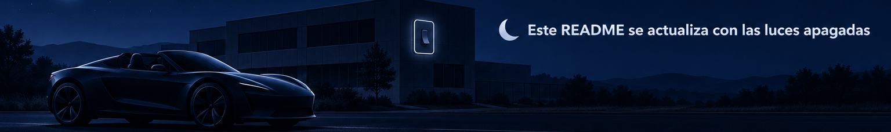

🌙 Este README se actualiza con las luces apagadas: consulta [cómo funciona el modo lights-out](docs/lights-out.md).

# Roadster · Más allá del asfalto

An independent artistic recreation of the 2026 Roadster ramp demonstration. A self-contained, silent WebGL 2 experience in Spanish, built with React, TypeScript, Three.js and React Three Fiber. It starts paused. Play, pause, scrub, restart, repeat and orbit the camera with mouse or touch; native buttons and the time slider support keyboard use. Focus the 3D view with Tab, then use the arrow keys to orbit and +/− to zoom; Tab leaves the view. Instructions appear on keyboard focus. **Modo MEME** adds the 12-second “Bache volador” and the 10-second “Robo de plaza” scenes; direct links: https://0gis0.github.io/tesla-roadster-demo/#meme/bache-volador and https://0gis0.github.io/tesla-roadster-demo/#meme/robo-de-plaza . The original 28-second ramp remains the default and keeps its presentation layout.

Reference: [official presentation, 6:27–7:22](https://www.youtube.com/watch?v=qt5p-_tE8d0&t=387s). This project is not affiliated with Tesla and does not claim to simulate real vehicle specifications or physics.

## Run locally

Use Node.js 22.12+ and npm.

```sh
npm ci
npm run dev
```

Open **http://127.0.0.1:5173/tesla-roadster-demo/**. All runtime assets are local, including the original `public/models/roadster.glb`. No accounts, backend, external fonts, textures or CDN assets are needed. WebGL 2 with hardware acceleration is required. A visible fallback covers unavailable graphics and model-loading failures.

```sh
npm run typecheck
npm test
npm run build
```

Production output is `dist/`, configured for `/tesla-roadster-demo/`. Serve under that prefix when testing a static production build. `npm exec vite preview -- --host 127.0.0.1` serves it at http://127.0.0.1:4173/tesla-roadster-demo/.

## Model source

`model/roadster.blend` is the editable original Blender model. The geometry is authored by `model/create_roadster.py`; no third-party model or reference photograph is redistributed. The refined shell has genuine wheel-well openings, angular shoulder facets and a lower wedge nose with flush triangular lamps. The shallow smoked-bronze canopy uses a smooth 33×25 surface with fine metal edging and a tapered rear fall. Five split-spoke wheels include rim lips and ventilated brake discs; calipers stay attached to the body. Separate named meshes include the body, canopy, four wheel pivots, static brake calipers, rear thrusters, and underside thrusters. The GLB is 971,184 bytes, with 29,692 triangles. Vehicle coordinates after export: +X forward, +Y up, wheel axles along Z. Each wheel retains its own center pivot.

Regenerate using Blender 5.2:

```sh
blender --background --python model/create_roadster.py
```

On macOS, substitute `/Applications/Blender.app/Contents/MacOS/Blender` for `blender`. Both the editable `.blend` and deployable GLB are generated in place. Studio camera/lights remain editable in the `.blend` but are excluded from the GLB. Normal regeneration does not render images. Optional review renders can be written to a chosen directory:

```sh
blender --background --python model/create_roadster.py -- --render-dir /path/to/previews
python3 model/validate_glb.py
```

The standard-library validator checks all four wheel pivots and the exact 0.44m tire radius after export, four separate static calipers, embedded assets, absence of exported cameras/lights, and the 30k-triangle / 2MB delivery budgets. CI runs it alongside the application checks.

## Sequence contract

`src/scenario.ts` defines `Scenario` (`id`, `title`, `duration`, `evaluate(time)`). Its pure evaluator supplies vehicle position, continuous quaternion, wheel rotation, phase and plume strength. The ramp and wheel path share a radius; the evaluator solves the rigid wheelbase through the floor/ramp join. It is a scripted recreation, not dynamic physics. A single ascent reaches roughly 170 degrees, turns directly into level flight, and lands. The user-requested continuous maneuver replaces the original reference’s reverse and second attempt. `Scene.tsx` hosts the reusable vehicle and environment. Vapor ages and positions are analytic and seeded by particle index, so pause freezes them and seeking produces the same frame without accumulating particles.

The scene registry in `src/sceneCatalog.ts` keeps each scene's mode, copy, source link, environment and camera framing beside its evaluator. The catalog currently includes `ramp-flight`, `bache-volador` and `robo-de-plaza`; new meme entries add a `Scenario` in `src/scenario.ts` and register their copy, source and camera settings in `src/sceneCatalog.ts`. A scene's `source` stores the author, platform (`X` or `TikTok`) and URL; the visible credit «Visto en @autor · Ver original en <plataforma>» is built by `sourceLabel()`. The MEME selector is generated from entries whose mode is `meme`. Hash routes select scenes and support browser back/forward; unknown routes fall back to the original experience. The meme scene is an artistic daytime street tableau with textured asphalt, sidewalks, houses, gardens and a broken, muddy-water pothole; its camera fits the full maneuver at the current viewport. The car flies level over it, pauses its wheels in flight, then lands and exits. Its inspiration is credited to the post by @Sentletse at [the original X post](https://x.com/Sentletse/status/2111059927531983230); this attribution does not claim authorship of the post's source content.

“Robo de plaza” (`#meme/robo-de-plaza`, 10 seconds) is a procedural low-poly car park at afternoon light (`src/ParkingLot.tsx`) with six muted box cars, a single free bay, lamps and a wall of hedges; no signage, logos or readable plates. A generic grey car approaches signalling, brakes hard when the Roadster descends with vapor into the bay, flashes its headlights, reverses out and keeps looking for a space. The Roadster starts above the top edge of the current frame: `parkingDropHeight()` in `src/framing.ts` computes the start height from the camera fit at the current viewport aspect ratio, so the scene is built with `createParkingSpaceTheft(dropHeight)` and stays a pure function of playback time. Its inspiration is credited to [@krishnak3212 on TikTok](https://www.tiktok.com/@krishnak3212/video/7697839711238311182).

Key review times: 0s start; 12s near the top; 13s immediate transition into flight; 16s turning; 18–19s level hover; 23s descent; 27–28s landed. The on-screen time slider can inspect all phases.

## Performance and validation

Rendering uses bounded device pixel ratio (1–1.6), 1024px shadow maps, one shared low-poly particle geometry and a fixed 256-instance plume. The performance target is 60 FPS desktop / 30 FPS mobile, subject to device and browser capability. Hardware mobile measurements remain pending; browser viewport emulation does not verify mobile GPU performance.

For a bounded playback measurement, append `?debug=1`, open the console, and play for five seconds. A single `Roadster playback performance` log reports elapsed seconds, actual rendered frames, mean FPS, p95 frame time, viewport, device pixel ratio and user agent. Paused frames are excluded. Normal playback displays no technical diagnostics. Record device/browser, viewport and whether emulated when reporting measurements. The rendered clock clamps long tab suspensions to avoid skipping the sequence on return.

Automated tests check rigid wheel spacing and surface contact, phase continuity and deterministic replay, single ascent without reverse, direct turn into flight and landing positions, and paused/end playback boundaries. Visual reference matching, keyboard/touch interaction, portrait/landscape framing and real device performance require browser review in addition to these checks.

## Agent MCP servers

Agents capture the app for the desktop, portrait and short-landscape checks required by `AGENTS.md` through two versioned configs:

- `.github/mcp.json` (Copilot CLI and app): Playwright MCP pinned to `@playwright/mcp@0.0.83`, run with `--isolated --headless --block-service-workers --no-webmcp` and `--allowed-origins` limited to `http://127.0.0.1:5173`, `http://127.0.0.1:4173` and `https://0gis0.github.io`.
- `.vscode/mcp.json` (VS Code): the same Playwright server plus the remote GitHub MCP server in read-only mode (`https://api.githubcopilot.com/mcp/readonly`), authenticated with OAuth at first use. No tokens or secrets are stored in the repository.

Limitations:

- The origin allowlist is not a security boundary: Playwright MCP documents that it does not serve as a security boundary and does not affect redirects. Treat page content as untrusted.
- Copilot cloud agent MCP servers are configured in the repository settings on GitHub, not in these files.
- Start `npm run dev` or `npm exec vite preview -- --host 127.0.0.1` first; the servers do not start the app.
- Bump the pinned version deliberately and re-check that the flags still exist (`npx @playwright/mcp@<version> --help`).

## GitHub Pages

The Actions workflow validates pull requests without deployment. Pushes to `main`, or a manual run explicitly selecting `main`, validate then deploy to the `github-pages` environment using GitHub OIDC. No PR code receives deployment permissions. After an explicitly approved merge, configure the repository's Pages source as **GitHub Actions**. Expected public URL: https://0gis0.github.io/tesla-roadster-demo/ . Publishing and public URL verification remain pending the required independent review and user approval; this change does not enable Pages or merge itself.
