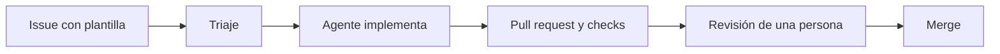

# Fábrica de software

> **Propósito:** explicar el recorrido de un cambio: plantilla de issue → triaje → agente → revisión → merge.
> **Qué mantener:** las plantillas y etiquetas, las reglas de triaje (resumen), los controles de CI y la propiedad de código. Revisa esta página cuando cambien `.github/ISSUE_TEMPLATE/`, `.github/skills/triage-issue/`, `.github/workflows/` o `.github/CODEOWNERS`.

## Recorrido

## 1. Issue con plantilla

Los issues en blanco están desactivados (`.github/ISSUE_TEMPLATE/config.yml`). Plantillas disponibles:

| Plantilla | Etiquetas iniciales |
|---|---|
| 🖼️ Propuesta de escena MEME | `🖼️ meme`, `🔍 needs-triage` |
| 🐞 Reportar un bug | `🐛 bug`, `🔍 needs-triage` |
| ✨ Mejora de la web | `✨ enhancement`, `🔍 needs-triage` |
| 🏭 Cambio en la software factory | `🏭 software-factory`, `🔍 needs-triage` |

El workflow `validate-issue-templates.yml` valida las plantillas con `check-jsonschema`.

## 2. Triaje

El triaje es una skill: `.github/skills/triage-issue/`. Su `SKILL.md` describe el procedimiento y `references/reglas.md` contiene las reglas y los ejemplos. Una Automation («🚦 Triaje de la fábrica») la usa en cada issue nuevo; su prompt solo debe decir algo como «usa la skill `triage-issue` para triar este issue». Otra Automation («🔁 La fábrica aprende») propone cambios a `references/reglas.md` siempre mediante una pull request que revisa una persona.

Como vive en `.github/skills/`, todo cambio al triaje pasa por el workflow `🥷 Validate skills`: `waza check`, el recuento de tokens y la comparación con `main` (`waza tokens compare`, umbral del 10 %). Así lo que aprende la fábrica queda medido por waza antes de que lo revise una persona. Resumen de las decisiones:

- `✅ agent-ready`: meme con descripción y referencia, o fallo reproducible.
- `📐 needs-spec`: algo nuevo que no es un meme o que toca varias partes de la web.
- `💬 needs-info`: falta imagen o enlace, texto del meme, o no se sabe qué falla.
- `💡 lights-on`: la luz por defecto; el cambio lo revisa una persona.
- `🌙 lights-out`: solo lo pone una persona admin al crear el issue; el triaje nunca lo añade y solo lo mantiene si pasa el freno (ver más abajo).
- Según el tipo: los issues `🏭 software-factory` nunca son `🌙 lights-out` y siempre llevan `💡 lights-on`, de modo que los revisa siempre una persona.
- Complejidad: el triaje pone siempre una de `🟢 complexity-low` (1–2 archivos, sin lógica nueva, se comprueba de un vistazo: favicon, textos, enlaces, meta tags, documentación), `🟡 complexity-medium` (funcionalidad acotada, varios archivos o recursos que generar; toda escena `🖼️ meme`) o `🔴 complexity-high` (modelo 3D, arquitectura, dependencias nuevas o alcance abierto).
- Freno de `🌙 lights-out`: una persona admin puede crear el issue con `🌙 lights-out` para pedir que lo resuelva un agente sin intervención humana, y el triaje decide si de verdad puede ir por ese carril. Solo se mantiene con `✅ agent-ready` + `🟢 complexity-low` y sin `🖼️ meme` ni `🏭 software-factory`; en cualquier otro caso lo cambia por `💡 lights-on` y explica el motivo en su comentario. El triaje nunca añade `🌙 lights-out`, y los memes no se disparan nunca solos.

El detalle y los ejemplos están en `.github/skills/triage-issue/references/reglas.md`; esa es la fuente.

## 3. Agente

Un agente implementa el issue siguiendo `AGENTS.md` y `.github/copilot-instructions.md`, apoyado en las skills y el MCP descritos en [Skills y MCP](skills-y-mcp.md). Sigue GitHub Flow: rama enfocada con el número del issue y commits Conventional Commits.

## 4. Pull request y checks

- `ci-pages.yml` → job `validate`: lint, tipos, pruebas, validación del GLB y build. Es el check que exige el ruleset.
- `docs.yml` → job `📚 docs`: ejecuta `markdownlint-cli2` y `scripts/check-markdown-links.mjs` en cada PR y en pushes a `main`. Es el segundo check obligatorio, junto a `🧪 validate`.
- `validate-skills.yml`: valida las skills de `.github/skills/` (waza, con versión y checksum fijados) cuando cambian.
- `validate-issue-templates.yml`: valida las plantillas cuando cambian.
- `pr-labels.yml` → `🏷️ PR labels`: copia a la PR las etiquetas de los Issues que cierra (`Closes`/`Fixes #N`) y etiqueta las PR que modifican las reglas del triaje, para poder filtrar por categoría y por `💡 lights-on` / `🌙 lights-out`. Detalle en [Etiquetas de las PR](#etiquetas-de-las-pr).
- Los workflows llevan emoji en el `name:` y en los de cada step, y las acciones se fijan por SHA completo de commit.
- Las PR solo validan: el despliegue se ejecuta tras un push a `main` o con una ejecución manual sobre `main`.

### Etiquetas de las PR

El workflow `🏷️ PR labels` (`.github/workflows/pr-labels.yml`) se ejecuta al abrir, reabrir, editar o actualizar (`synchronize`) una PR y al sacarla de borrador. Lee los Issues que la PR cierra (`closingIssuesReferences`) y le añade sus etiquetas de categoría (`🖼️ meme`, `🏭 software-factory`, `🤖 agents`, `📝 documentation`…) y de luces (`💡 lights-on` / `🌙 lights-out`).

- **Regla de aprendizaje del triaje:** si la PR modifica `.github/skills/triage-issue/references/reglas.md`, añade `🔁 triage-learning`, `🏭 software-factory`, `🤖 agents` y `💡 lights-on`, aunque la haga una persona y no cierre ningún Issue. Lee solo los nombres de archivo con la API (`pulls/N/files`, paginada). Se vuelve a evaluar en cada `synchronize` porque el agente de Copilot abre la PR antes de subir los commits.
- **No copia** las etiquetas de estado del Issue: `🔍 needs-triage`, `✅ agent-ready`, `📐 needs-spec`, `💬 needs-info`, `🧑‍🏫 triage-corrected`, `♻️ duplicate`, `⛔ wontfix` y `🚫 invalid`.
- **Nunca quita** etiquetas que la PR ya tenga. Si la PR no cierra ningún Issue ni toca las reglas, termina bien sin cambios.
- **Seguridad:** usa `pull_request_target`, así que corre desde `main` con `GITHUB_TOKEN` y permisos mínimos (`contents: read`, `issues: read`, `pull-requests: write`). No hace checkout ni ejecuta código de la PR; solo llama a la API con `gh`.
- **Manual:** `workflow_dispatch` con el número de la PR sirve para etiquetar una PR existente o repetir la ejecución.
- **Cloud agent:** las ejecuciones de workflows disparadas por PR abiertas por el cloud agent pueden quedar a la espera de «Approve and run workflows». Está pendiente de comprobar con la primera PR real; si ocurre, se aprueba la ejecución o se lanza `🏷️ PR labels` a mano con `workflow_dispatch`.

## 5. Revisión y merge

`.github/CODEOWNERS` asigna `@0GiS0` y `@returngis-demo` como propietarias de la web (regla `*`, `model/` y `public/models/`) y solo a `@0GiS0` de `AGENTS.md`, `.github/` y `.vscode/`. Quién revisa qué se detalla en [Guardarraíles](guardarrailes.md#quién-revisa-qué). El agente no fusiona por su cuenta: la integración requiere aprobación explícita, y antes de abrir una PR se hace una revisión independiente del diff.
