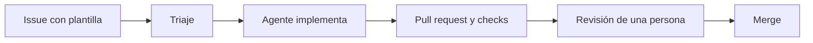

# Fábrica de software

> **Propósito:** explicar el recorrido de un cambio: plantilla de issue → triaje → agente → revisión → merge.
> **Qué mantener:** las plantillas y etiquetas, las reglas de triaje (resumen), los controles de CI y la propiedad de código. Revisa esta página cuando cambien `.github/ISSUE_TEMPLATE/`, `.github/triage/reglas.md`, `.github/workflows/` o `.github/CODEOWNERS`.

## Recorrido

## 1. Issue con plantilla

Los issues en blanco están desactivados (`.github/ISSUE_TEMPLATE/config.yml`). Plantillas disponibles:

| Plantilla | Etiquetas iniciales |
|---|---|
| 🖼️ Propuesta de escena MEME | `🖼️ meme`, `🔍 needs-triage` |
| 🐞 Reportar un bug | `🐛 bug`, `🔍 needs-triage` |
| ✨ Mejora de la web | `✨ enhancement`, `🔍 needs-triage` |
| 🏭 Cambio en la software factory | `🏭 software-factory`, `🔍 needs-triage` |

El workflow `validate-issue-templates.yml` valida las plantillas con `check-jsonschema`.

## 2. Triaje

Las reglas viven en `.github/triage/reglas.md` y las lee una Automation («🚦 Triaje de la fábrica») en cada issue nuevo. Otra Automation («🔁 La fábrica aprende») propone cambios a ese archivo siempre mediante una pull request que revisa una persona. Resumen de las decisiones:

- `✅ agent-ready`: meme con descripción y referencia, o fallo reproducible.
- `📐 needs-spec`: algo nuevo que no es un meme o que toca varias partes de la web.
- `💬 needs-info`: falta imagen o enlace, texto del meme, o no se sabe qué falla.
- `💡 lights-on`: cambia lo que ve el público.
- `🌙 lights-out`: solo cambia documentación o inventario (pie de foto, texto alternativo, lista de memes); tiene prioridad sobre `💡 lights-on`.
- Según el tipo: los issues `🏭 software-factory` nunca son `🌙 lights-out` y siempre llevan `💡 lights-on`, de modo que los revisa siempre una persona.

El detalle y los ejemplos están en `.github/triage/reglas.md`; esa es la fuente.

## 3. Agente

Un agente implementa el issue siguiendo `AGENTS.md` y `.github/copilot-instructions.md`, apoyado en las skills y el MCP descritos en [Skills y MCP](skills-y-mcp.md). Sigue GitHub Flow: rama enfocada con el número del issue y commits Conventional Commits.

## 4. Pull request y checks

- `ci-pages.yml` → job `validate`: lint, tipos, pruebas, validación del GLB y build. Es el check que exige el ruleset.
- `validate-skills.yml`: valida las skills de `.github/skills/` (waza, con versión y checksum fijados) cuando cambian.
- `validate-issue-templates.yml`: valida las plantillas cuando cambian.
- Los workflows llevan emoji en el `name:` y en los de cada step, y las acciones se fijan por SHA completo de commit.
- Las PR solo validan: el despliegue se ejecuta tras un push a `main` o con una ejecución manual sobre `main`.

## 5. Revisión y merge

`.github/CODEOWNERS` asigna `@0GiS0` y `@returngis-demo` como propietarias de la web (regla `*`, `model/` y `public/models/`) y solo a `@0GiS0` de `AGENTS.md`, `.github/` y `.vscode/`. Quién revisa qué se detalla en [Guardarraíles](guardarrailes.md#quién-revisa-qué). El agente no fusiona por su cuenta: la integración requiere aprobación explícita, y antes de abrir una PR se hace una revisión independiente del diff.
