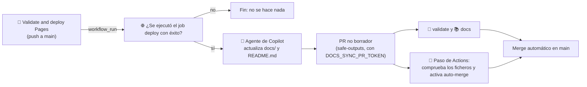

# 🌙 Lights-out

*Lights-out* es el modo en el que una PR se mergea sin revisión humana porque el cambio es seguro por construcción. Hoy solo aplica a la documentación.

## Qué cubre

- Los ficheros bajo `docs/`.
- El `README.md` de la raíz, que también es lights-out y se actualiza tras cada despliegue a producción. Lleva arriba un banner que lo indica.
- `docs/` y `README.md` no tienen propietario en `.github/CODEOWNERS` (entradas `/docs/` y `/README.md` sin owners, después de `*`), así que el ruleset de `main` no exige revisión del propietario del código.
- Los únicos requisitos son los checks obligatorios `🧪 validate` y `📚 docs`: si están en verde, la PR puede mergearse.

## Quién activa el auto-merge

No hay un flujo genérico por etiqueta. El Agentic Workflow [`📚 Docs sync`](../.github/workflows/docs-sync.md) mantiene la documentación y activa el auto-merge solo en sus propias PR. Para ello el repositorio debe tener activada la opción *Allow auto-merge*.

## Cómo funciona `📚 Docs sync`

El workflow está escrito con [GitHub Agentic Workflows](https://github.github.com/gh-aw/) (gh-aw). El fichero editable es `.github/workflows/docs-sync.md`; `.github/workflows/docs-sync.lock.yml` es el resultado compilado y es el que ejecuta Actions.



1. **Disparador.** Un `workflow_run` sobre «🚀 Validate and deploy Pages», solo en `main` y solo si la ejecución terminó en éxito. Además hay una ejecución diaria (`schedule: daily`) que recoge los despliegues descartados por el punto 3 mientras había una PR abierta; si no hay nada que actualizar, el agente termina sin abrir PR. También se puede lanzar a mano con `workflow_dispatch`.
2. **Comprobación del despliegue.** Una ejecución en éxito no basta: en un push que solo toca documentación, `🔍 changes` hace que `🧪 validate` y `🌐 deploy` se salten y la ejecución sigue constando como correcta. Por eso un paso previo consulta los jobs de la ejecución y solo continúa si `🌐 deploy` terminó en `success`. Así las PR de documentación no lanzan el workflow y no hay bucle.
3. **Sin solapes.** Si ya hay una PR abierta de este workflow (etiqueta `🌙 lights-out` y título que empieza por `docs:`), el workflow no hace nada.
4. **Agente.** Copilot compara las páginas con el código (si no coinciden, manda el código), solo puede editar `docs/` y `README.md` y no toca las páginas históricas. Si no hay nada que actualizar, termina sin abrir PR.
5. **PR.** La crea el job `safe_outputs` con `draft: false`. Cualquier fichero fuera de `docs/**` y `README.md` hace que la salida se bloquee (`allowed-files`). `README.md` está protegido por defecto por gh-aw y se permite de forma explícita; `AGENTS.md`, `CODEOWNERS` y `.github/` siguen protegidos.
6. **Auto-merge.** El job `🔀 Enable auto-merge` se ejecuta fuera del agente, con el `GITHUB_TOKEN` del propio workflow. Solo actúa sobre la PR recién creada: comprueba que no es borrador, que sale de este repositorio hacia `main` y que todos sus ficheros (incluidos los nombres anteriores en renombrados) están bajo `docs/` o son `README.md`. Si es así, ejecuta `gh pr merge --auto --squash`. Si no, no hace nada y la PR queda para revisión humana.

### Por qué hace falta un token propio para la PR

Las PR creadas con el `GITHUB_TOKEN` por defecto no disparan workflows de `pull_request`: los checks obligatorios nunca se ejecutarían y el auto-merge no llegaría a completarse. Por eso la PR se crea con `safe-outputs.create-pull-request.github-token`, un token personal. La PR la firma entonces la propietaria del token y sus checks se ejecutan con normalidad.

### Secreto necesario

Se crea en *Settings → Secrets and variables → Actions → New repository secret*. No hay ningún secreto versionado.

| Secreto | Para qué | Cómo crearlo |
| --- | --- | --- |
| `DOCS_SYNC_PR_TOKEN` | Crea la rama y la PR para que se ejecuten los checks obligatorios. | Token *fine-grained* de la misma cuenta, con *Repository access* limitado a este repositorio y los permisos **Contents: Read and write**, **Pull requests: Read and write** y **Metadata: Read**. No necesita el permiso *Workflows*, porque solo escribe en `docs/` y `README.md`. |

Con la CLI, `gh aw secrets set DOCS_SYNC_PR_TOKEN --value "<token>"` lo guarda en el repositorio. Conviene ponerle una caducidad y renovarlo antes de que venza.

La inferencia del agente no necesita ningún secreto: el workflow declara `copilot-requests: write` y el motor de Copilot usa el token de Actions.

### Cómo se compila

Tras cualquier cambio en `docs-sync.md`, hay que recompilar y versionar el `.lock.yml`:

```sh
gh aw compile docs-sync --action-mode action --action-tag <SHA-del-commit-de-la-etiqueta-de-gh-aw-actions> --approve
```

El SHA es el del commit al que apunta la etiqueta de la versión de `github/gh-aw-actions` que fija el `.lock.yml` (se obtiene con `git ls-remote https://github.com/github/gh-aw-actions 'refs/tags/<versión>*'`, tomando la entrada con `^{}`). Se pasa explícitamente porque, en cuentas con SAML, la API puede devolver 403 al resolver la etiqueta.

### Excepciones a las convenciones de workflows

El `.lock.yml` lo genera gh-aw y no se edita a mano, así que no puede cumplir al cien por cien las convenciones del repositorio:

- Los jobs generados (`activation`, `agent`, `detection`, `safe_outputs`, `conclusion`, `pre_activation`) y sus pasos no llevan emoji en el `name:`. Sí lo llevan el `name:` del workflow, el job `🔀 Enable auto-merge` y los pasos escritos a mano.
- `github/gh-aw-actions/setup` está fijada por SHA, pero sin comentario con la versión.
- `actionlint` marca falsos positivos en este fichero (`queue` en `concurrency` y `job.workflow_ref`) porque la versión instalada no conoce esas claves de GitHub Actions.

## Qué sigue protegido

Todo lo que está fuera de `docs/` sigue teniendo propietario y necesita su revisión: código, `model/`, `public/models/`, `.github/`, `.vscode/` y `AGENTS.md`. Una PR que mezcle `docs/` o `README.md` con cualquiera de esas rutas requiere revisión humana, porque CODEOWNERS se evalúa por fichero.
