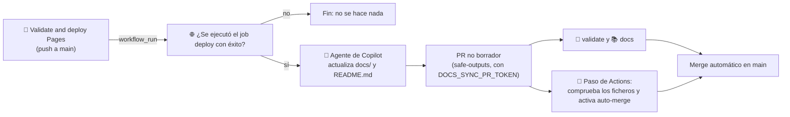

# 🌙 Lights-out

*Lights-out* es el modo en el que una PR se mergea sin revisión humana porque el cambio es seguro por construcción. Aplica a la documentación y a las PR pequeñas del cloud agent para Issues `🌙 lights-out`.

## Qué cubre

- Los ficheros bajo `docs/`.
- El `README.md` de la raíz, que también es lights-out y se actualiza tras cada despliegue a producción. Lleva arriba un banner que lo indica. El bloque entre `<!-- tour:start -->` y `<!-- tour:end -->` es el tour en vídeo (ver `docs/desarrollo.md`): por ahora se regenera a mano con la skill `record-tour` (`npm run tour`) y el flujo de docs-sync no debe tocarlo. Su regeneración automática llegará en #70.
- `docs/` y `README.md` no tienen propietario en `.github/CODEOWNERS` (no hay regla `*` ni entradas para ellos), así que el ruleset de `main` no exige revisión del propietario del código.
- Los únicos requisitos son los checks obligatorios `🧪 validate` y `📚 docs`: si están en verde, la PR puede mergearse.

## Quién activa el auto-merge

Para las PR del cloud agent, el workflow [`🔀 Lights-out auto-merge`](#auto-merge-de-las-pr-del-cloud-agent). Para la documentación, no hay un flujo genérico por etiqueta: el Agentic Workflow [`📚 Docs sync`](../.github/workflows/docs-sync.md) mantiene la documentación y activa el auto-merge solo en sus propias PR. Para ello el repositorio debe tener activada la opción *Allow auto-merge*.

## Cómo funciona `📚 Docs sync`

El workflow está escrito con [GitHub Agentic Workflows](https://github.github.com/gh-aw/) (gh-aw). El fichero editable es `.github/workflows/docs-sync.md`; `.github/workflows/docs-sync.lock.yml` es el resultado compilado y es el que ejecuta Actions.



1. **Disparador.** Un `workflow_run` sobre «🚀 Validate and deploy Pages», solo en `main` y solo si la ejecución terminó en éxito. Además hay una ejecución diaria (`schedule: daily`) que recoge los despliegues descartados por el punto 3 mientras había una PR abierta; si no hay nada que actualizar, el agente termina sin abrir PR. También se puede lanzar a mano con `workflow_dispatch`.
2. **Comprobación del despliegue.** Una ejecución en éxito no basta: en un push que solo toca documentación, `🔍 changes` hace que `🧪 validate` y `🌐 deploy` se salten y la ejecución sigue constando como correcta. Por eso un paso previo consulta los jobs de la ejecución y solo continúa si `🌐 deploy` terminó en `success`. Así las PR de documentación no lanzan el workflow y no hay bucle.
3. **Sin solapes.** Si ya hay una PR abierta de este workflow (etiqueta `🌙 lights-out` y título que empieza por `docs:`), el workflow no hace nada.
4. **Agente.** Copilot compara las páginas con el código (si no coinciden, manda el código), solo puede editar `docs/` y `README.md` y no toca las páginas históricas. Antes de abrir la PR ejecuta `markdownlint` y la comprobación de enlaces, y un paso posterior en el runner las repite. Si no hay nada que actualizar, termina sin abrir PR.
5. **PR.** La crea el job `safe_outputs` con `draft: false`. Cualquier fichero fuera de `docs/**` y `README.md` hace que la salida se bloquee (`allowed-files`). `README.md` está protegido por defecto por gh-aw y se permite de forma explícita; `AGENTS.md`, `CODEOWNERS` y `.github/` siguen protegidos.
6. **Auto-merge.** El job `🔀 Enable auto-merge` se ejecuta fuera del agente, con el `GITHUB_TOKEN` del propio workflow. Solo actúa si el job `agent` terminó en verde (incluye las comprobaciones de Markdown del paso 4, ver [Guardarraíles](guardarrailes.md#agent-hooks-lint-y-markdown-antes-de-la-pr)) y solo sobre la PR recién creada: comprueba que no es borrador, que sale de este repositorio hacia `main` y que todos sus ficheros (incluidos los nombres anteriores en renombrados) están bajo `docs/` o son `README.md`. Si es así, ejecuta `gh pr merge --auto --squash`. Si no, no hace nada y la PR queda para revisión humana.

### Por qué hace falta un token propio para la PR

Las PR creadas con el `GITHUB_TOKEN` por defecto no disparan workflows de `pull_request`: los checks obligatorios nunca se ejecutarían y el auto-merge no llegaría a completarse. Por eso la PR se crea con `safe-outputs.create-pull-request.github-token`, un token personal. La PR la firma entonces la propietaria del token y sus checks se ejecutan con normalidad.

### Secreto necesario

Se crea en *Settings → Secrets and variables → Actions → New repository secret*. No hay ningún secreto versionado.

| Secreto | Para qué | Cómo crearlo |
| --- | --- | --- |
| `DOCS_SYNC_PR_TOKEN` | Crea la rama y la PR para que se ejecuten los checks obligatorios. | Token *fine-grained* de la misma cuenta, con *Repository access* limitado a este repositorio y los permisos **Contents: Read and write**, **Pull requests: Read and write** y **Metadata: Read**. No necesita el permiso *Workflows*, porque solo escribe en `docs/` y `README.md`. |

Con la CLI, `gh aw secrets set DOCS_SYNC_PR_TOKEN --value "<token>"` lo guarda en el repositorio. Conviene ponerle una caducidad y renovarlo antes de que venza.

La inferencia del agente no necesita ningún secreto: el workflow declara `copilot-requests: write` y el motor de Copilot usa el token de Actions.

### Cómo se compila

Tras cualquier cambio en `docs-sync.md`, hay que recompilar y versionar el `.lock.yml`:

```sh
gh aw compile docs-sync --action-mode action --action-tag <SHA-del-commit-de-la-etiqueta-de-gh-aw-actions> --approve
```

El SHA es el del commit al que apunta la etiqueta de la versión de `github/gh-aw-actions` que fija el `.lock.yml` (se obtiene con `git ls-remote https://github.com/github/gh-aw-actions 'refs/tags/<versión>*'`, tomando la entrada con `^{}`). Se pasa explícitamente porque, en cuentas con SAML, la API puede devolver 403 al resolver la etiqueta.

### Excepciones a las convenciones de workflows

El `.lock.yml` lo genera gh-aw y no se edita a mano, así que no puede cumplir al cien por cien las convenciones del repositorio:

- Los jobs generados (`activation`, `agent`, `detection`, `safe_outputs`, `conclusion`, `pre_activation`) y sus pasos no llevan emoji en el `name:`. Sí lo llevan el `name:` del workflow, el job `🔀 Enable auto-merge` y los pasos escritos a mano.
- `github/gh-aw-actions/setup` está fijada por SHA, pero sin comentario con la versión.
- `actionlint` marca falsos positivos en este fichero (`queue` en `concurrency` y `job.workflow_ref`) porque la versión instalada no conoce esas claves de GitHub Actions.

## Asignación automática de Issues sencillos

El workflow `🌙 Lights-out assign` (`.github/workflows/lights-out-assign.yml`) pasa al carril autónomo los Issues que el triaje deja sencillos y listos.

### Condiciones

Se evalúan **todas las etiquetas actuales** del Issue en cada evento `labeled` (el orden en que el triaje las añade no está garantizado). Deben cumplirse a la vez:

- Issue abierto.
- `✅ agent-ready` y `🟢 complexity-low`.
- Al menos una etiqueta de área permitida. De momento `🎨 ux` y `♿ accessibility`; la lista es la variable `ALLOWED_AREA_LABELS` al principio del workflow. La etiqueta de área la pone el triaje (como máximo una, según `references/reglas.md` de la skill `triage-issue`) o una persona; sin ella el flujo no se activa.
- Ni `🖼️ meme` ni `🏭 software-factory`.
- Quien añadió la etiqueta (`github.event.sender`) tiene permiso `write` o superior.

### Qué hace

1. Asigna el Issue a `copilot-swe-agent[bot]` con `POST /repos/{owner}/{repo}/issues/{n}/assignees` y `agent_assignment.base_branch: main` (API en *public preview*).
2. Quita `💡 lights-on`, añade `🌙 lights-out` y deja un comentario con el motivo.

Es idempotente: no hace nada si el Issue ya está asignado a Copilot o ya tiene una PR abierta de Copilot. Las etiquetas y el comentario los pone el `GITHUB_TOKEN`, y sus eventos no disparan workflows, así que no hay bucle.

### Secreto para asignar el agente

| Secreto | Para qué | Cómo crearlo |
| --- | --- | --- |
| `COPILOT_ASSIGN_TOKEN` | Asignar Copilot al Issue. | Token *fine-grained* de usuario con **Metadata: Read** y **Actions**, **Contents**, **Issues** y **Pull requests**: Read and write. El `GITHUB_TOKEN` y los tokens de GitHub App no pueden asignar Copilot. |

Solo se usa en el paso de asignación; el resto de pasos usan el `GITHUB_TOKEN` con `issues: write`.

### Supuesto sobre el triaje

La Automation de triaje pone las etiquetas actuando como la propietaria (no como bot), por lo que su evento `labeled` debería disparar el workflow. Para comprobarlo tras el merge, abre un Issue de prueba con `✅ agent-ready`, `🟢 complexity-low` y `🎨 ux` (o deja que el triaje lo etiquete) y mira en *Actions → 🌙 Lights-out assign* si hay una ejecución con el actor correcto. Si el triaje no dispara el evento, habrá que añadir `workflow_dispatch` o un `schedule` corto.

### Riesgo de «Require approval for workflow runs»

Con *Settings → Copilot → Cloud agent → Require approval for workflow runs* activado, los checks de la PR del agente no se ejecutan hasta pulsar «Approve and run workflows», y el flujo se queda parado. Desactivarlo permite que el código de la PR de Copilot ejecute workflows sin aprobación humana: es un riesgo aceptado solo si los checks obligatorios, los permisos mínimos de los workflows y la revisión de la PR siguen protegiendo `main`.

## Auto-merge de las PR del cloud agent

El workflow `🔀 Lights-out auto-merge` (`.github/workflows/lights-out-automerge.yml`) cierra el carril: activa el auto-merge en la PR que el cloud agent abre para un Issue `🌙 lights-out`. Es el equivalente al job `🔀 Enable auto-merge` de docs-sync.

### Cuándo actúa

Se dispara con `pull_request_target` (`review_requested`, `ready_for_review`, `synchronize` y `edited`, este último para cambios en los Issues enlazados) y con `workflow_dispatch`. Lee el estado actual de la PR y solo continúa si se cumple **todo** (lógica en `.github/scripts/lights-out-guard.sh`):

- La PR está abierta, la firma Copilot, la rama sale de este repositorio y apunta a `main`.
- Tiene al menos un Issue enlazado (palabras clave de cierre) y todos están abiertos y con `🌙 lights-out`.
- El diff es pequeño: hasta 150 líneas cambiadas (`MAX_CHANGED_LINES`) y 10 ficheros (`MAX_CHANGED_FILES`), variables al principio del workflow.
- Ningún fichero, incluidos los nombres anteriores en renombrados, está en `.github/`, `.vscode/`, `model/` o `public/models/`, ni es `AGENTS.md`, `package.json` o `package-lock.json` de la raíz.

Si se cumple, saca la PR de borrador y ejecuta `gh pr merge --auto --squash --match-head-commit <SHA evaluado>`. Si no se cumple, no hace nada y la PR queda para revisión humana (el motivo aparece en el resumen de la ejecución). Si una PR de Copilot deja de ser elegible tras un nuevo push o una edición, el workflow cancela su auto-merge. Los checks obligatorios `🧪 validate` y `📚 docs` siguen siendo la barrera final.

Límites conocidos, aceptados porque el auto-merge de GitHub es persistente: el SHA solo se fija al activarlo, y la cancelación es una evaluación posterior, no una barrera previa al merge. Además, cerrar el Issue o quitarle `🌙 lights-out` con el auto-merge ya activo no reevalúa la PR; en ese caso hay que desactivarlo a mano (`gh pr merge <n> --disable-auto`). Un push con permiso de escritura a la rama de Copilot por parte de la propietaria se considera de confianza.

### Por qué `pull_request_target` y `COPILOT_ASSIGN_TOKEN`

- Con `pull_request_target` el workflow y el script del guardarraíl salen siempre de `main`: una PR no puede editarlos para llegar al token. El workflow no descarga ni ejecuta código de la PR.
- Los permisos del `GITHUB_TOKEN` son `contents: read`, `pull-requests: write` e `issues: read`. Este último es imprescindible: sin él, la consulta GraphQL de los Issues enlazados devuelve una lista vacía y la PR se rechazaría con «no linked Issue». Si la consulta falla, el job termina con error en vez de tratar la PR como «sin Issue».
- Un merge hecho con el `GITHUB_TOKEN` no lanza workflows en el push a `main`, así que `🚀 Validate and deploy Pages` no se ejecutaría y la web no se desplegaría. Por eso el paso que saca la PR de borrador y activa el auto-merge usa el secreto `COPILOT_ASSIGN_TOKEN` (el de la asignación, ver arriba); el resto de pasos usan el `GITHUB_TOKEN`.

### Probarlo a mano

*Actions → 🔀 Lights-out auto-merge → Run workflow*, en `main`, con el número de la PR. Aplica exactamente los mismos guardarraíles. Sirve para una PR ya existente, para la que no habrá un evento nuevo.

### Pruebas de los guardarraíles

```sh
bash .github/scripts/lights-out-guard.test.sh
```

Cubre casos sintéticos: PR válida, rutas protegidas (incluido un renombrado desde una ruta protegida), límites de líneas y ficheros, Issue sin `🌙 lights-out` o cerrado, sin Issue, autor distinto de Copilot, rama de fork y destino distinto de `main`.

## Qué sigue protegido

Solo la gobernanza y el modelo 3D siguen teniendo propietario y necesitan su revisión: `.github/`, `.vscode/`, `AGENTS.md`, `model/` y `public/models/`. Una PR que mezcle cualquier otra ruta con esas requiere revisión humana, porque CODEOWNERS se evalúa por fichero.

El código de la web (`src/` y demás) ya no tiene propietario, para que las PR de Issues lights-out que lo tocan no queden bloqueadas. Como consecuencia, las PR humanas que tocan solo código de la web tampoco necesitan revisión de propietario: las barreras son los checks obligatorios `🧪 validate` y `📚 docs`.
